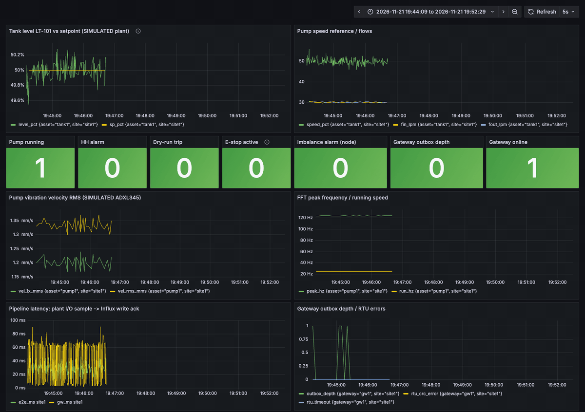
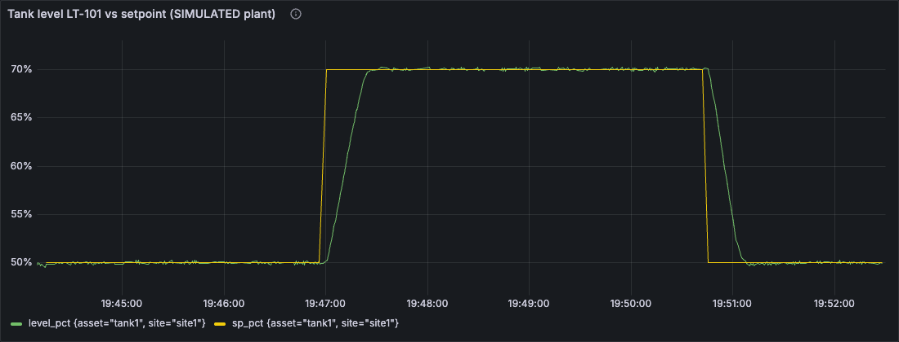
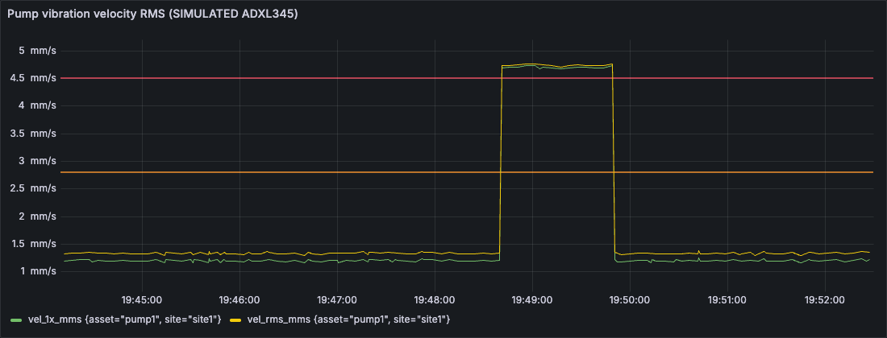
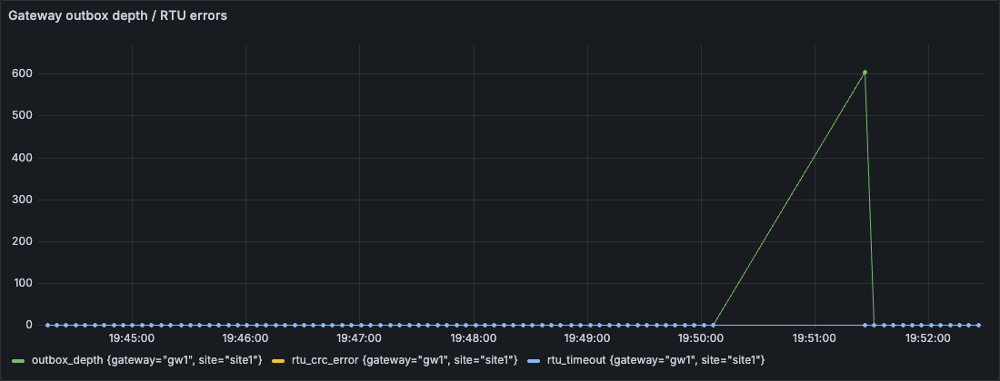
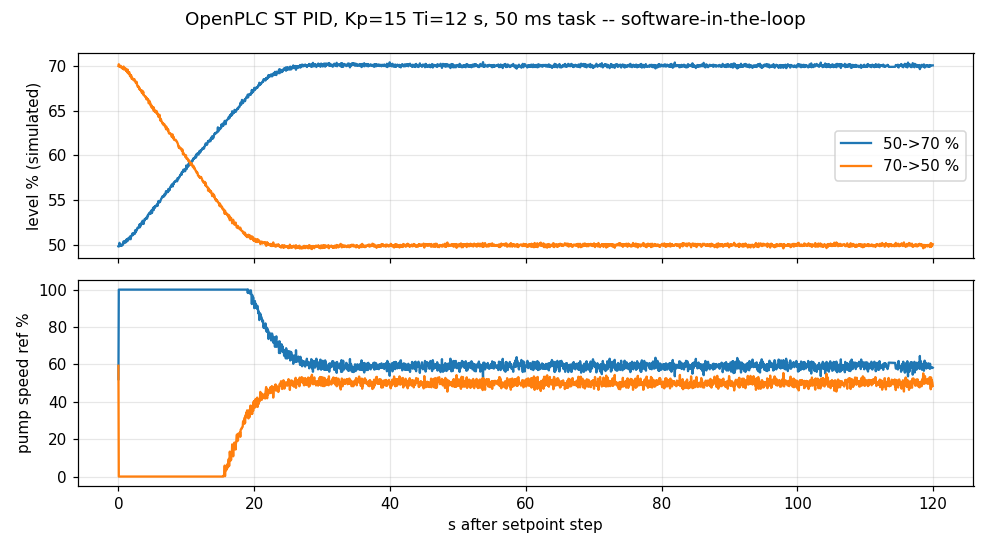
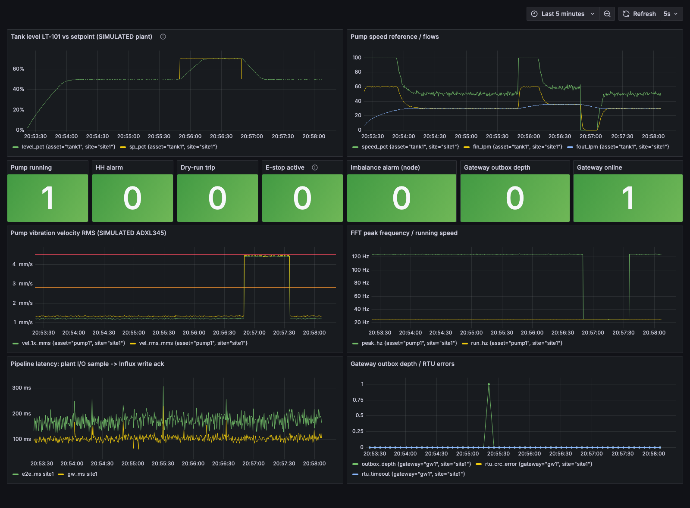

# Tank Level Control & Pump Condition Monitoring: an IIoT software-in-the-loop testbed

An end-to-end industrial-IoT stack that runs entirely on a laptop:

> **A real IEC 61131-3 program in OpenPLC** controls a **simulated tank** over
> **Modbus TCP**. A **simulated ESP32 vibration node** answers **Modbus RTU**
> over a virtual serial line. An **edge gateway** buffers everything in
> **SQLite** and ships it over **MQTT/TLS** to **InfluxDB + Grafana**. Every
> number in the results table was measured on this stack by the scripts in
> `bench/`.



*Time-lapse of about 6 min on the running stack (about 16× speed): setpoint step 50→70 %, an injected pump-imbalance fault, then a 75 s broker outage during which the setpoint goes back to 50 %; that step appears once the gateway backfills its outbox. Plant and vibration are simulated. [MP4](docs/media/scenario.mp4)*

## What is real and what is simulated

| Part | Status |
|---|---|
| Tank, pump, valve, float switches, E-stop | **Simulated.** Python model (`iiot/plant_model.py`) served by pymodbus. |
| PLC | **Real software:** OpenPLC v3 runtime built from source for arm64, running `plc/tank_control.st`. |
| PID + interlocks | **Real IEC 61131-3 ST**, compiled by matiec and executed by OpenPLC every 20 ms (50 ms before v2). |
| ADXL345 accelerometer / pump vibration | **Simulated.** A synthetic signal with injectable imbalance. |
| ESP32 firmware | **Compiles** with PlatformIO (esp32dev, Arduino). **Never flashed or run on hardware.** Its DSP and Modbus C code are unit-tested on the host against the emulator. |
| RS-485 link | **Simulated.** A socat virtual serial pair plus a "wire" that emulates 19200-baud byte timing and bit errors. |
| Gateway, MQTT/TLS broker, ingestor, InfluxDB, Grafana, alerts | **Real software**, in Docker. |
| Network | One Docker host. All latencies are local and every container shares one clock. |

## Architecture

```
          OT network (ot_net)                         │            IT network (it_net)
                                                       │
 ┌───────────────┐   Modbus TCP    ┌───────────────┐   │
 │ plant (SIM)   │◄───────────────►│  OpenPLC v3   │   │
 │ tank+pump+    │  PLC = master,  │  ST PID 20 ms │   │
 │ valve, :5020  │  polled 10 ms   │  interlocks   │   │
 │ test API:8081 │                 │  :502  :8080  │   │
 └───────────────┘                 └──────▲────────┘   │
                                          │ Modbus TCP (read-only)
                                   ┌──────┴────────┐   │   MQTT 3.1.1 / TLS1.2+ mTLS, QoS 1
 ┌───────────────┐  Modbus RTU     │   gateway     │───┼──────────────►┌───────────┐   ┌──────────┐   ┌──────────┐   ┌─────────┐
 │ vibnode (SIM) │  19200 8N1      │ TCP 20/RTU 2Hz│   │  LWT+retained │ Mosquitto │──►│ ingestor │──►│ InfluxDB │──►│ Grafana │
 │ ESP32 regmap  │◄───────────────►│ SQLite outbox │   │    status     │ ACL by CN │   │ manual   │   │ 2.7      │   │ + alerts│
 │ test API:8082 │ socat pty pair  │ seq no., RBE  │   │               │ persist.  │   │ ack+dedup│   └──────────┘   └─────────┘
 └───────────────┘ + "wire" (BER)  └───────────────┘   │               └───────────┘   └──────────┘
                                   dual-homed edge box  │
   E-stop: hardwired in the (simulated) field. Never on MQTT, never through the gateway.
```

Read [`docs/DESIGN.md`](docs/DESIGN.md) for a component-by-component
explanation.

**v2 (this revision):** 119 tags (was 40) in 3 batched requests per cycle.
The PLC is polled at 20 Hz (was 2 Hz), with report-by-exception. End-to-end
latency p99 is down from 223 ms to the value in the results table. See
"Report-by-exception and the latency budget" below.

## Run it

Prerequisites: Docker (tested on Docker Desktop 29, Apple Silicon) and Python 3.12
for the test scripts.

```bash
./scripts/gen_certs.sh                 # self-signed lab CA + broker/client certs (once)
docker compose up -d --build           # first build compiles OpenPLC from source (~10 min)
```

`docker compose up` brings everything up already programmed. The OpenPLC
container's `plc/provision.py` drives OpenPLC's own web endpoints: it logs in,
uploads and compiles `tank_control.st`, registers the plant as a Modbus slave
device, enables the Modbus server and run-mode, then starts the PLC and pulses
START.

| URL | What |
|---|---|
| http://localhost:3300 | Grafana (anonymous viewer; admin / `iiot-lab-password`) |
| http://localhost:8080 | OpenPLC UI (`openplc` / `openplc`, lab only) |
| http://localhost:9100 | gateway metrics (JSON) |
| http://localhost:9101 | ingestor metrics (JSON) |
| `curl -XPOST localhost:8081/control -d '{"dry_run":true}'` | plant fault injection (also `estop`, `valve_pct`, `level_pct`) |
| `curl -XPOST localhost:8082/control -d '{"imbalance_mms":3}'` | vibration fault injection (also `ber`) |

Memory caps total about 2.3 GB. Actual use while running was about 520 MB (`docker stats`).

Gateway settings (environment, `docker-compose.yml`): `PLC_POLL_HZ` (20), `VIB_POLL_HZ` (2),
`RBE` (1 = report-by-exception, 0 = publish every poll), `INTEGRITY_S` (5 s full
snapshot). Plant/PLC: `PLANT_DT_S` (0.01 s), `OPENPLC_SLAVE_POLL_MS` (10).

### Tests and measurements

```bash
python3.12 -m venv .venv && .venv/bin/pip install -r requirements-dev.txt
.venv/bin/python -m pytest -q                         # 47 unit tests (no Docker needed)
.venv/bin/python bench/interlock_test.py              # E-stop, dry-run, HH, I/O watchdog
.venv/bin/python bench/step_response.py --cycles 3    # PID 50<->70 % steps on OpenPLC
.venv/bin/python bench/plc_tcp_bench.py --n 10000
docker exec iiot-gateway python bench/rtu_bench.py --n 10000 --ber 0 --timeout 0.2
RBE=0 docker compose up -d gateway                   # publish every 20 Hz poll (max sample count)
.venv/bin/python bench/latency.py --minutes 15 --out latency_rbe_off.json
docker compose up -d gateway                         # back to report-by-exception (default)
.venv/bin/python bench/latency.py --minutes 15
.venv/bin/python bench/outage_test.py --cycles 1 --duration 120 --mode broker --tag v2_broker_1x120s
.venv/bin/python bench/imbalance_test.py --trials 20
.venv/bin/python tools/results_table.py              # regenerates the table below
cd firmware/vibration-node && ../../.venv/bin/pio run # ESP32 build (compile only)
```

## Register maps

### Plant I/O (simulated field devices; Modbus TCP slave, unit 1, port 5020), polled by OpenPLC

| Table | Addr | Tag | Scaling | PLC address |
|---|---|---|---|---|
| DI | 0 | ESTOP_OK (hardwired NC chain healthy) | bool | %IX100.0 |
| DI | 1 | PUMP_FB (VFD running) | bool | %IX100.1 |
| DI | 2 | LSHH float switch (95 %) | bool | %IX100.2 |
| DI | 3 | LSLL float switch (5 %) | bool | %IX100.3 |
| IR | 0 | LT-101 level | % × 100 | %IW100 |
| IR | 1 | FT-101 inflow | L/min × 10 | %IW101 |
| IR | 2 | FT-102 outflow | L/min × 10 | %IW102 |
| IR | 3 | IT-101 motor current | A × 100 | %IW103 |
| IR | 4, 5 | sample time, uint32 ms (hi, lo) | ms | %IW104/105 |
| IR | 6 | sample counter (I/O watchdog) | count | %IW106 |
| IR | 7 | outlet valve position | % × 100 | %IW107 |
| Coil | 0 | pump run command | bool | %QX100.0 |
| HR | 0 | pump speed reference | % × 100 | %QW100 |
| HR | 1 | PLC heartbeat (plant stops pump if stale 2 s) | count | %QW101 |

### PLC tag map (OpenPLC Modbus server, port 502; host port 5502)

The gateway reads the whole map in **2 requests**: FC03 HR 0–49 and FC01 coils 0–25.
The decoder is `iiot/telemetry.py` (`PLC_HR_MAP`, `COIL_NAMES`). `tests/test_plc_tagmap.py`
checks it against the `AT %QW` / `%QX` declarations in `plc/tank_control.st`.

| HR | Tag | | HR | Tag |
|---|---|---|---|---|
| 0 | level % × 100 | | 25 | HH limit % × 100 (9500) |
| 1 | active setpoint % × 100 | | 26 | LL limit % × 100 (500) |
| 2 | pump speed ref % × 100 | | 27, 28 | pump runtime s, uint32 (hi, lo) |
| 3 | inflow L/min × 10 | | 29 | pump start counter |
| 4 | outflow L/min × 10 | | 30 | dry-run trip counter |
| 5 | motor current A × 100 | | 31 | fail-to-start trip counter |
| 6 | valve % × 100 | | 32 | HH trip counter |
| 7 | plant sample time hi | | 33 | E-stop activation counter |
| 8 | plant sample time lo | | 34 | I/O fault counter |
| 9 | plant sample counter | | 35 | first-out trip: 0 none, 1 E-stop, 2 HH, 3 dry run, 4 FTS, 5 I/O |
| 10 | status word (bits below) | | 36 | dry-run timer elapsed, ms |
| 11 | PLC scan counter | | 37 | fail-to-start timer elapsed, ms |
| 12 | PID error % × 100 (INT) | | 38 | I/O-stale timer elapsed, ms |
| 13 | mode 0 stop / 1 auto / 2 manual | | 39 | sensor quality word (bits below) |
| 14 | Kp × 100 | | 40 | interlock word: b0 E-stop OK, b1 not HH, b2 not dry, b3 not FTS, b4 not I/O fault, b5 permissive |
| 15 | Ti s × 10 | | 41 | raw DI word: b0 ESTOP_OK, b1 PUMP_FB, b2 LSHH, b3 LSLL, b4 run command |
| 16 | Td s × 100 | | 42 | net flow in − out, L/min × 10 (INT) |
| 17 | PID output % × 100 | | 43 | level, 2 s filter, % × 100 |
| 18 | PID P term % × 100 (INT) | | 44 | level rate of change, %/min × 100 (INT) |
| 19 | PID I term % × 100 (INT) | | 45 | heartbeat sent to the plant |
| 20 | PID D term % × 100 (INT) | | 46 | seconds since last start |
| 21 | operator setpoint entry (before the 90 % clamp) | | 47 | active alarm/trip count |
| 22 | manual speed % × 100 | | 48 | scan interval ms (20) |
| 23 | H limit % × 100 (8500) | | 49 | program version (0x0200) |
| 24 | L limit % × 100 (1500) | | | |

**Status bits / coils 0–9:**

| Bit | Meaning |
|---|---|
| 0 | run |
| 1 | AL_H |
| 2 | AL_L |
| 3 | AL_HH (trip) |
| 4 | AL_LL |
| 5 | DRY_TRIP (latched) |
| 6 | E-stop active |
| 7 | permissive |
| 8 | fail-to-start trip |
| 9 | I/O fault |

Status-word-only bits: 10 manual, 11 PID saturated.

**Coils 10–25 (v2):**

| Coil | Meaning |
|---|---|
| 10 | manual |
| 11 | PID saturated |
| 12–14 | raw DIs PUMP_FB, LSHH, LSLL |
| 15 | run command to the field |
| 16–18 | dry-run, fail-to-start and I/O-stale timers running |
| 19 | LT-101 bad (out of range or frozen) |
| 20 | FT-101 bad |
| 21 | FT-102 bad |
| 22 | IT-101 bad |
| 23 | LSHH disagrees with LT-101 |
| 24 | LSLL disagrees with LT-101 |
| 25 | any trip active |

**Quality word (HR 39) bits:**

| Bit | Set when |
|---|---|
| b0 | LT-101 > 100 % |
| b1 | LT-101 frozen ≥ 5 s (a live transmitter is never noise-free) |
| b2 | FT-101 > 90 L/min |
| b3 | FT-102 > 90 L/min |
| b4 | IT-101 > 10 A, or 0 A for 1 s while running ≥ 30 % |
| b5 | LSHH on below 90 %, or off above 98 % |
| b6 | LSLL on above 10 %, or off below 2 % |
| b7 | I/O stale |

Quality is diagnostic only. No trip depends on it.

**HMI writes:**

| HR | Contents |
|---|---|
| 1024 (%MW0) | setpoint % × 100 |
| 1025 | command bits: 0 START, 1 STOP, 2 RESET (pulses, cleared by PLC), 3 MANUAL |
| 1026 | manual speed |
| 1027 | Kp × 100 |
| 1028 | Ti × 10 |
| 1029 | Td × 100 |

### Vibration node (Modbus RTU slave, unit 10, RS-485, 19200 8N1)

Source of truth: `firmware/vibration-node/include/regmap.h` and `iiot/vib_regmap.py`.
The two are kept in sync by a test.

| FC04 IR | Content | Scaling |
|---|---|---|
| 0 | status: b0 sensor OK, b1 window valid, b2 velocity alert, b3 imbalance | bits |
| 1 | radial (X) acceleration RMS | mg |
| 2 | velocity RMS 10–400 Hz | mm/s × 100 |
| 3 | FFT peak frequency (Hann, parabolic interp.) | Hz × 10 |
| 4 | FFT peak amplitude | mg |
| 5 | 1x velocity RMS (±1 bin at running speed) | mm/s × 100 |
| 6 | running-speed estimate | Hz × 10 |
| 7 | window counter | count |
| 8, 9 | uptime (hi, lo) | s |
| 10–12 | X/Y/Z acceleration RMS | mg |
| 13 | firmware version (0x0101) | 0xMMmm |
| 14 | sample rate (800) | Hz |
| 15 | window length (512) | samples |
| 16, 17 | Y / Z velocity RMS 10–400 Hz | mm/s × 100 |
| 18–20 | X/Y/Z peak acceleration, max \|a − mean\| | mg |
| 21–23 | X/Y/Z crest factor (peak / RMS; sine 1.41) | × 100 |
| 24–26 | X/Y/Z kurtosis m4/m2² (sine 1.5, Gaussian 3, impacting bearing > 4) | × 100 |
| 27–30 | X acceleration RMS in bands 5–50, 50–150, 150–300, 300–400 Hz | mg × 10 |
| 31–33 | velocity at 2x, 3x, 5x (vane pass), ±1 bin | mm/s × 100 |
| 34–36 | X/Y/Z mean (gravity vector / mounting), INT16 | mg |
| 37 | bearing-housing temperature, NTC on ADC1 (SIMULATED in the emulator), INT16 | °C × 100 |
| 38 | clipped samples in the last window | count |
| 39 | ADXL345 FIFO overruns since boot | count |
| 40 | I2C errors since boot | count |
| 41, 42 | velocity-alert / imbalance debounce counters | windows |
| 43 | ISO 10816-3 zone (group 2, rigid): 1 A, 2 B, 3 C, 4 D | enum |

All 44 registers are read in **one** FC04 request. That is 8 + 93 bytes, or 52.6 ms on the wire at 19200 baud.
The emulator also accepts `{"bearing_g": 0.4}`. This adds an impact train at 3.1x that raises kurtosis, crest factor and band 4.

| FC03/06/16 HR | Content | Default |
|---|---|---|
| 0 | overall velocity alert | 450 (4.5 mm/s) |
| 1 | imbalance (1x) alarm | 280 (2.8 mm/s) |
| 2 | debounce windows | 3 |
| 3 | unit id (read-only) | 10 |

## Design decisions in one paragraph each

**PLC logic.** The PID is an ST function block:
* derivative on measurement;
* filtered D;
* conditional-integration anti-windup;
* bumpless auto/manual.

Interlocks are rung-for-rung ST equations: start/stop seal-in, dry-run trip
(TON 3 s, latched), fail-to-start, HH trip (transmitter OR float switch), and an
I/O-stale watchdog. **They are ST, not ladder.** OpenPLC's runtime compiler
(matiec) only accepts textual languages. LD → ST conversion lives in the GUI
OpenPLC Editor, which cannot be driven headlessly here. Each rung's ladder is
drawn as ASCII art above its equation in `plc/tank_control.st`.

**Store-and-forward.**
* Every poll snapshot is committed to SQLite *before* any network I/O. Its row
  id (AUTOINCREMENT, never reused) is the message sequence number.
* Rows are deleted only on PUBACK.
* The ingestor PUBACKs only after InfluxDB confirms the write.
* Every point is timestamped with the gateway poll time carried in the message,
  so a QoS 1 redelivery rewrites the identical point instead of adding one.
  Duplicates are harmless, and the seq numbers let the tests count them.

**Safety boundary.** The gateway is read-only, and nothing on MQTT can command
the plant. The E-stop is hardwired in the (simulated) field and de-energises the
contactor directly. The PLC and the dashboard only *see* it.

**Report-by-exception and the latency budget (v2).**
* **Pollers.** The PLC is polled at 20 Hz and the vibration node at 2 Hz, each in
  its own thread. The 55 ms RS-485 transaction no longer delays the PLC data
  (before v2 it sat in front of every MQTT publish).
* **Deadbands.** Each poll goes through `iiot/rbe.py`. A tag is published only when
  it has moved by more than its deadband since its last *published* value.
  * Comparing against the last published value means a slow ramp is still reported.
  * Booleans, enums, words and event counters publish on any change.
  * Clocks and free-running counters (scan count, heartbeat, runtime) never trigger
    a publish on their own.
  * The plant sample timestamp rides on every PLC message.
* **Integrity snapshot.** A full snapshot of all tags goes out every 5 s, and after
  any bad poll. It proves liveness, refreshes the counters and bounds how stale any
  tag can be in InfluxDB.
* **Deadband values** come from the measured noise of the simulated signals:
  * The level deadband is 0.25 %, against 0.10 % σ transmitter noise.
  * Kp = 15 turns that noise into about 1.5 % σ of PID-output jitter, so the output
    and P-term deadbands are 3 % and 5 %.
  * Measured over 15 min: the PLC source sent 4.2 messages/s instead of 20 polls/s,
    carrying 1.9 % of the polled tag values. The vibration source sent 1.0 message/s
    (2 polls/s), carrying 11.6 % of its tag values. Most PLC messages are the noisy
    PID terms. Wider deadbands would cut that further, at the price of resolution.
* **Latency, stage by stage.** Before v2 the 223 ms p99 was mostly fixed waits.
  * Plant I/O refresh: 50 → 100 Hz.
  * OpenPLC slave poll: 50 → 10 ms.
  * OpenPLC scan: 50 → 20 ms. The PID sample time follows `SCAN_MS`; a test keeps it
    equal to the task interval.
  * The RTU transaction was moved out of the PLC path.
  * The gateway drainer is woken by an Event instead of a 20 ms sleep.
  * TCP_NODELAY is set on every MQTT socket, including the broker's (`set_tcp_nodelay`).
  * The ingestor no longer waits 50 ms to fill a batch. It writes whatever is already
    queued, so a reconnect backlog still produces large batches.
  * The `pipeline_latency` write is off the critical path.

## Results

### v2 results: 119 tags, 3 requests per cycle, PLC polled at 20 Hz, report-by-exception

Measured on 2026-11-20 on the same host. Load average during the runs was 3–5,
with another heavy Docker job running at the same time. **The plant and the
vibration signal are simulated in every row.** Raw data is in `results/*.json`.
The v1 files are kept in `results/history_v1_40tags/`.

| | v1 (history) | v2 |
|---|---|---|
| Tags | 40 | **119** (74 PLC + 45 vibration) |
| Requests per cycle | 3 (FC03×16, FC01×10, FC04×16) | **3** (FC03×50, FC01×26, FC04×44) |
| Poll rate | 2 Hz, all serial | PLC **20 Hz**; RTU 2 Hz in its own thread |
| e2e latency p50 / p99 (plant sample → Influx ack) | 170 / 223 ms, n = 1,800 | **28 / 56 ms**, n = 3,749 (RBE on); 27 / 65 ms, n = 14,298 (RBE off) |
| gateway part p99 / sample age p99 | 142 / 102 ms | 38 / 40 ms (RBE on) |
| RTU errors per 10k at BER 0 | 0 | **0** (isolated run; 7 in a run that overlapped a TCP load test, see caveats) |
| Outage, broker stop | 0 lost / 0 dup (6 × 120 s mixed, among others) | **0 lost / 0 dup** (1 × 120 s, 823 msgs) |
| Unit tests | 28 | **47** |

| Metric (all SIMULATED plant/sensor) | Result | Method |
|---|---|---|
| PID step 50→70 %: settling, ±2 % of span | 20.9 s | 1 steps on OpenPLC loop, 20 Hz sampling |
| PID step 50→70 %: settling, ±2 % of step (±0.4 % level) | 53.7 s | same runs |
| PID step 50→70 %: overshoot | 2.05 % of step | same runs |
| PID step 50→70 %: steady-state error band (last 30 s) | [-0.37, +0.36] σ=0.10 % level | includes 0.10 % σ simulated transmitter noise |
| PID step 70→50 %: settling, ±2 % of span | 17.6 s | 1 steps on OpenPLC loop, 20 Hz sampling |
| PID step 70→50 %: settling, ±2 % of step (±0.4 % level) | 28.5 s | same runs |
| PID step 70→50 %: overshoot | 2.20 % of step | same runs |
| PID step 70→50 %: steady-state error band (last 30 s) | [-0.36, +0.30] σ=0.10 % level | includes 0.10 % σ simulated transmitter noise |
| Modbus RTU, simulated BER 0: errors per 10k polls | 0 (CRC 0, timeout 0) | 10000 back-to-back FC04×44 regs @19200 8N1 emulated wire timing, 200 ms timeout; isolated run |
| Modbus RTU, BER 0: max poll rate / OK latency p50, p99 | 16.5 polls/s; 60.0, 65.7 ms | theoretical wire time 52.6 ms |
| Modbus RTU, simulated BER 0: errors per 10k polls | 7 (CRC 0, timeout 7) | 10000 back-to-back FC04×44 regs @19200 8N1 emulated wire timing, 200 ms timeout; run concurrently with bench/plc_tcp_bench.py (2k TCP cycles/s on the same host); errors were slave-side framing timeouts, 0 corrupted bytes |
| Modbus RTU, BER 0: max poll rate / OK latency p50, p99 | 16.1 polls/s; 60.4, 79.7 ms | theoretical wire time 52.6 ms |
| Modbus TCP to OpenPLC: poll cycles/s, errors per 10k | 1975.5 cycles/s, 0 errors | 10000 × (FC03 50 regs + FC01 26 coils), host→Docker; p50 0.46 ms, p99 1.38 ms |
| End-to-end latency plant I/O sample → InfluxDB write ack, p50 / p99 — RBE off, every poll published | 27 / 65 ms (max 43302) | 14298 PLC messages over 15.0 min at 20.0 Hz polling, 119 tags |
|   of which gateway poll → InfluxDB ack, p50 / p99 | 6 / 60 ms | MQTT/TLS + broker + ingestor + Influx write |
|   of which sample age at gateway poll, p50 / p99 | 20 / 40 ms | plant I/O refresh + OpenPLC slave poll + scan |
|   messages/s sent (PLC, vibration) / polls/s | 16.59, 1.66 / 16.59, 1.66 | tag values sent / polled: PLC 100.0 %, vibration 100.0 % |
| End-to-end latency plant I/O sample → InfluxDB write ack, p50 / p99 — RBE on (default) | 28 / 56 ms (max 129) | 3749 PLC messages over 15.0 min at 20.0 Hz polling, 119 tags |
|   of which gateway poll → InfluxDB ack, p50 / p99 | 8 / 38 ms | MQTT/TLS + broker + ingestor + Influx write |
|   of which sample age at gateway poll, p50 / p99 | 19 / 40 ms | plant I/O refresh + OpenPLC slave poll + scan |
|   messages/s sent (PLC, vibration) / polls/s | 4.16, 1.03 / 20.0, 2.0 | tag values sent / polled: PLC 1.9 %, vibration 11.6 % |
| Outage test `v2_broker_1x120s`: 1 × 120 s (broker) | lost 0, duplicate rows 0, duplicate deliveries 0 | 823 msgs checked by seq in InfluxDB |
|   backfill time / backlog per outage | 0.1 s/698 | CONNACK → last pre-reconnect row PUBACKed by broker; 119 field values per msg |
| Interlock: field E-stop pressed | PASS, 0.05 s | fault injected via plant test API |
| Interlock: no auto-restart after E-stop released | PASS | fault injected via plant test API |
| Interlock: dry run (suction lost) | PASS, 3.01 s | fault injected via plant test API |
| Interlock: dry-run latch holds until RESET | PASS | fault injected via plant test API |
| Interlock: high-high level (LSHH / >=95 %) | PASS, 0.03 s | fault injected via plant test API |
| Interlock: plant I/O frozen (docker pause plant) | PASS, 2.0 s | fault injected via plant test API |

**Dashboard captures (v2, 2026-11-21).** These are from the scenario in the animation at the top. They illustrate the stack's behaviour; they are not part of the measured results. [Full dashboard](docs/media/dashboard_full.png).



*LT-101 level against setpoint: step 50→70 % at 19:47, and 70→50 % at 19:50:44 while the broker was down (written to InfluxDB after reconnect).*



*Injected 1x imbalance (+3.5 mm/s) crosses the 2.8 mm/s imbalance line; the node's imbalance flag reached InfluxDB 1.7 s after injection.*



*Gateway outbox depth during a 75 s `docker stop` of the broker: about 600 messages queued in SQLite, then drained in 0.04 s after reconnect.*

**Caveats on the v2 numbers:**
* **Latency tail.** In the RBE-off run the max was 43 s. The ingestor went silent
  long enough for the broker's keepalive to drop it, three times, at 19:05–19:10.
  The queued messages arrived late when it reconnected, and nothing was lost
  (3 duplicate deliveries, written idempotently). 42 of 14,298 messages (0.3 %)
  exceeded 500 ms, so p99 is unaffected. Two earlier events, outside the window,
  dropped the gateway and the ingestor in the same second. That points to host/VM
  stalls under the concurrent job. The root cause of the ingestor-only events was
  not isolated. The ingestor now uses a separate Influx client for the latency
  points and counts its disconnects (`/metrics`). The RBE-on run that followed
  had 0 disconnects and a max of 129 ms.
* **RBE-off poll rate.** In the RBE-off run the gateway sustained about 16.6 polls/s,
  not 20; the message count confirms it. The RBE-on run held 20.0. The cause was not
  isolated. The RBE-off run is a sample-count cross-check. The default configuration
  is RBE on.
* **RTU at BER 0.** The first 10k run overlapped `bench/plc_tcp_bench.py`, which drives
  2,000 TCP cycles/s on the same host. It had 7 timeouts, 0 CRC errors and 0 corrupted
  bytes; 3 of them were requests the emulated slave saw with a bad CRC. That is
  scheduling jitter on the socat/pty "wire", not the bus. The isolated re-run had 0
  errors, with p99 65.7 ms against 52.6 ms of wire time and a 200 ms timeout.
* **What changed in the control loop.** The PLC scan went from 50 to 20 ms and the
  plant I/O from 50 to 100 Hz. The PID step was re-run once (1 up, 1 down step)
  and the interlock suite in full. Settling, overshoot and trip times match v1
  within run-to-run spread. The trip timings are slightly faster.
* **Not re-run in v2:** the imbalance campaign, the BER 1e-5 / 1e-4 RTU runs and the
  long outage campaign. Their rows are in the v1 table below. Each RTU poll is now 101
  bytes instead of 45, so expect roughly 2× the per-poll error rate at a given BER.
* **One E-stop press counted twice.** After the interlock suite, the new event
  counters read 1 dry-run, 1 HH and 1 I/O-fault trip, which is right. The E-stop
  counter read 2 for one press. The second count is most likely the frozen-plant
  case, where the PLC reads ESTOP_OK = 0 while its slave link is down. That is
  correct fail-safe behaviour, but it counts as an E-stop event.

### v1 results (history): 40 tags, PLC polled at 2 Hz, 50 ms scan, no RBE

These numbers were produced on 2026-11-20, before v2. Their JSON is in
`results/history_v1_40tags/` (latency, RTU, PLC TCP, interlocks, step response) and in `results/outage_*.json`. The host is an Apple Silicon Mac with 8 GB allotted to
Docker, shared with another heavy job (load average was 17–43 during the runs).
**The plant and the vibration signal are simulated in every row.**





| Metric (all SIMULATED plant/sensor) | Result | Method |
|---|---|---|
| PID step 50→70 %: settling, ±2 % of span | 20.9, 21.0, 20.9 s | 3 steps on OpenPLC loop, 20 Hz sampling |
| PID step 50→70 %: settling, ±2 % of step (±0.4 % level) | 24.9, 26.4, 57.1 s | same runs |
| PID step 50→70 %: overshoot | 1.90, 1.85, 1.90 % of step | same runs |
| PID step 50→70 %: steady-state error band (last 30 s) | [-0.29, +0.32] σ=0.10, [-0.32, +0.29] σ=0.10, [-0.35, +0.34] σ=0.10 % level | includes 0.10 % σ simulated transmitter noise |
| PID step 70→50 %: settling, ±2 % of span | 17.8, 17.7, 17.7 s | 3 steps on OpenPLC loop, 20 Hz sampling |
| PID step 70→50 %: settling, ±2 % of step (±0.4 % level) | 27.7, 20.8, 24.4 s | same runs |
| PID step 70→50 %: overshoot | 2.20, 2.00, 2.05 % of step | same runs |
| PID step 70→50 %: steady-state error band (last 30 s) | [-0.33, +0.29] σ=0.10, [-0.33, +0.35] σ=0.11, [-0.32, +0.29] σ=0.10 % level | includes 0.10 % σ simulated transmitter noise |
| Modbus RTU, simulated BER 0: errors per 10k polls | 0 (CRC 0, timeout 0) | 10000 back-to-back FC04×16 regs @19200 8N1 emulated wire timing, 200 ms timeout |
| Modbus RTU, BER 0: max poll rate / OK latency p50, p99 | 31.7 polls/s; 31.1, 36.9 ms | theoretical wire time 23.44 ms |
| Modbus RTU, simulated BER 1e-05: errors per 10k polls | 26 (CRC 23, timeout 3) | 10000 back-to-back FC04×16 regs @19200 8N1 emulated wire timing, 200 ms timeout |
| Modbus RTU, BER 1e-05: max poll rate / OK latency p50, p99 | 32.0 polls/s; 30.6, 40.8 ms | theoretical wire time 23.44 ms |
| Modbus RTU, simulated BER 0.0001: errors per 10k polls | 366 (CRC 288, timeout 78) | 10000 back-to-back FC04×16 regs @19200 8N1 emulated wire timing, 200 ms timeout |
| Modbus RTU, BER 0.0001: max poll rate / OK latency p50, p99 | 31.1 polls/s; 30.2, 34.7 ms | theoretical wire time 23.44 ms |
| Modbus TCP to OpenPLC: poll cycles/s, errors per 10k | 3700.3 cycles/s, 0 errors | 10000 × (FC03 16 regs + FC01 10 coils), host→Docker; p50 0.25 ms, p99 0.56 ms |
| End-to-end latency plant I/O sample → InfluxDB write ack, p50 / p99 | 170 / 223 ms (max 330) | 1800 messages over 15.0 min at 2.0 Hz polling |
|   of which gateway poll → InfluxDB ack, p50 / p99 | 103 / 142 ms | MQTT/TLS + broker + ingestor batch + Influx write |
|   of which sample age at gateway poll, p50 / p99 | 62 / 102 ms | PLC slave poll + scan + poll phase |
| Outage test `broker_kill_1x60s`: 1 × 60 s (kill) | lost 0, duplicate rows 0, duplicate deliveries 0 | 169 msgs checked by seq in InfluxDB |
|   backfill time / backlog per outage | 0.1 s/126 | CONNACK → last pre-reconnect row PUBACKed by broker; 40 field values per msg |
|   backlog fully written to InfluxDB after reconnect | 0.15 s | CONNACK → Influx write-ack of last queued msg (pipeline_latency) |
| Outage test `mixed_6x120s`: 6 × 120 s (alternate) | lost 0, duplicate rows 0, duplicate deliveries 0 | 1753 msgs checked by seq in InfluxDB |
|   backfill time / backlog per outage | 0.1 s/242, 0.1 s/248, 0.1 s/246, 0.2 s/257, 0.1 s/249, 0.1 s/249 | CONNACK → last pre-reconnect row PUBACKed by broker; 40 field values per msg |
|   backlog fully written to InfluxDB after reconnect | 0.20 s, 0.30 s, 0.23 s, 1.84 s, 0.29 s, 0.34 s | CONNACK → Influx write-ack of last queued msg (pipeline_latency) |
| Outage test `net_1x600s`: 1 × 600 s (net) | lost 0, duplicate rows 0, duplicate deliveries 0 | 1250 msgs checked by seq in InfluxDB |
|   backfill time / backlog per outage | 0.1 s/1205 | CONNACK → last pre-reconnect row PUBACKed by broker; 40 field values per msg |
|   backlog fully written to InfluxDB after reconnect | 0.87 s | CONNACK → Influx write-ack of last queued msg (pipeline_latency) |
| Imbalance detection, faults above 2.8 mm/s threshold | 15 / 15 | 20 seeded faults (+0.5…4.0 mm/s at 1x), judged in InfluxDB |
| Imbalance detection, faults below threshold (should not alarm) | 0 / 5 alarmed | same trials |
| Imbalance time-to-detect min / median / max | 1.38 / 1.9 / 2.24 s | 3-window debounce (0.64 s windows) + 2 Hz polling |
| Imbalance false alarms in healthy periods | 0 / 387 samples |  |
| Interlock: field E-stop pressed | PASS, 0.05 s | fault injected via plant test API |
| Interlock: no auto-restart after E-stop released | PASS | fault injected via plant test API |
| Interlock: dry run (suction lost) | PASS, 3.05 s | fault injected via plant test API |
| Interlock: dry-run latch holds until RESET | PASS | fault injected via plant test API |
| Interlock: high-high level (LSHH / >=95 %) | PASS, 0.07 s | fault injected via plant test API |
| Interlock: plant I/O frozen (docker pause plant) | PASS, 2.08 s | fault injected via plant test API |

**Outage parameters actually run** (not 20 × 10 min):
* 6 × 120 s alternating 3 × `docker network disconnect` of the gateway's IT leg and 3 × `docker stop` of the broker;
* 1 × 600 s network disconnect;
* 1 × 60 s `docker kill` (SIGKILL) of the broker.

In total that is 8 outages and 22 min of outage, across 3,172 messages. Each
message carries 40 field values, so the 10-min outage was about 48,200 values.

**Caveats on these numbers:**
* **Duplicates.** Zero duplicate deliveries were observed, so idempotency was not
  stressed by the outage runs themselves. It is proven by unit tests
  (`tests/test_telemetry_idempotent.py`, `tests/test_outbox.py`).
* **Broker kill.** The SIGKILL case lost nothing because the ingestor was
  consuming live, so the broker held no un-persisted queue at the moment of the
  kill. A kill during a large backlog could lose messages the broker had already
  PUBACKed. This case was not tested.
* **Latency is sensitive to host load.** An earlier 15-min run while the host's
  load average was 17–43 (another heavy job) gave a p99 of about 1.7 s. That run
  is discarded, because it was also contaminated by a timestamp-unwrap bug that
  has since been fixed (see `iiot/telemetry.py`). The reported run had a load
  average of about 4–7.
* **Watchdog trip.** During the campaign, the PLC's I/O watchdog tripped the pump
  once (19:44 local). The OpenPLC → plant Modbus link stalled for more than 2 s
  under host load. The PLC failed safe (IO_FAULT → permissive lost) and the pump
  stayed off until START. This is the watchdog working as designed. A real plant
  would tune the 200 ms slave timeout and the 2 s stale limit.
* **Grafana alerts** were observed going to *Alerting* for "gateway offline"
  (during outages) and "pump imbalance" (an injected 3.2 mm/s fault). The level
  and dry-run rules evaluate (state *Normal*). They were not held in fault long
  enough to fire during the interlock test.


## Known limitations

* Everything is software-in-the-loop on one host. There is no real fieldbus
  electrical behaviour, no clock skew and no WAN.
* The ESP32 firmware is unproven on hardware: DE/RE turnaround, I2C error
  handling and FIFO overruns are untested.
* Interlocks are written in ST, not graphical ladder. A real trip of this kind
  belongs in a safety-rated system, not a general-purpose soft-PLC.
* MQTT 3.1.1 JSON payloads are used, not Sparkplug B or OPC UA.
* Secrets (OpenPLC default login, Influx token, Grafana password) are lab
  defaults on purpose.

## Layout

```
plc/                 OpenPLC Dockerfile, tank_control.st, headless provisioner
firmware/vibration-node/   ESP32 PlatformIO project (regmap.h, vib_dsp.c, modbus_rtu_slave.c, main.cpp)
iiot/                shared Python: plant model, PID twin, RTU master/slave, DSP, outbox, telemetry
services/            plant, vibnode (emulator + wire), gateway, ingestor
bench/               measurement scripts -> results/
grafana/provisioning datasource, dashboard (generated by tools/build_dashboard.py), alert rules
mosquitto/           TLS-only broker config + ACL
tests/               pytest unit tests
```
